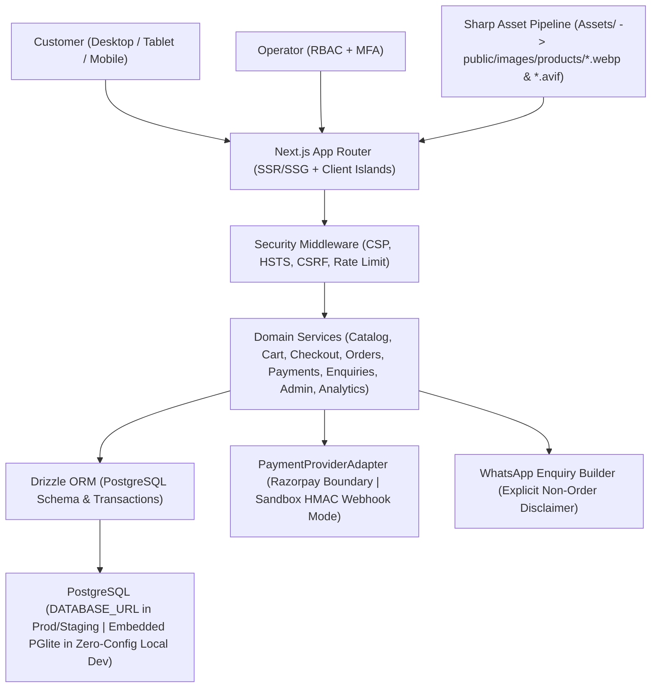

# Phase 0 — Repository, Asset & Baseline Audit
**Project:** Madurai Aanandha Masala (Provisional on-site spelling; social uses Anantha)  
**Audit Date:** 24 November 2026  
**Workspace:** `D:\spideyy\Software Development\madurai-anandham`

---

## 1. Repository Reconnaissance Summary
At the start of Phase 0, the repository contained **zero application code, zero `package.json`, zero tests, zero database schema, and no Git repository**:
- `gemini.md` (50,861 bytes) — Project operating brief & engineering contract.
- `MASTER-PROMPT.md` (21,232 bytes) — Execution strategy & delivery specification.
- `Assets/` — 35 JPEG product pouch photographs (`1.jpg` through `35.jpg`), all uniform `1170 × 1560` portrait resolution (~175 KB to 273 KB each, total ~7.7 MB uncompressed).

### Local Environment Verified
- OS: Windows
- Node.js: `v22.12.0` | npm: `10.9.0` | Python: `3.13.7`
- PostgreSQL 17 service installed (`postgresql-x64-17` running locally, requires credentials not yet provided in `.env`).

---

## 2. 35/35 Image Asset Audit Summary
Every image (`1.jpg`–`35.jpg`) was visually inspected at full resolution (`1170 × 1560`). Full machine-readable data lives in [asset-manifest-35.json](./asset-manifest-35.json) and [asset-manifest-35.md](./asset-manifest-35.md).

- **Total source files audited:** 35 / 35 (100%)
- **Canonical unique products discovered:** 25 (24 edible culinary products + 1 non-edible traditional herbal bath powder, **Kuliyal Podi / Nalangu Maavu**, explicitly segregated from food categories)
- **Canonical pack variants discovered:** 26 (`Manjal Podi` has both `100g` in `27.jpg` and `50g` in `29.jpg`)
- **Duplicate / alternate-edition photos:** 9 (`2.jpg` older edition of `35.jpg`; `3.jpg`/`25.jpg`; `4.jpg`/`8.jpg`; `6.jpg`/`17.jpg`; `7.jpg`/`12.jpg`; `9.jpg`/`10.jpg`; `15.jpg`/`28.jpg`; `18.jpg`/`30.jpg`; `19.jpg`/`26.jpg`)
- **Verified printed packaging facts (subject to owner confirmation):**
  - Packaging brand: **Madurai Aanandha Masala** (`மதுரை ஆனந்தா மசாலா`)
  - Printed FSSAI Lic. No.: `12423012000494`
  - Printed Villapuram address: `மீனாட்சி நகர், அருப்புக்கோட்டை மெயின்ரோடு, வில்லபுரம், மதுரை - 625012`
  - Printed contact: `98438 87337` (matches Instagram bio & YouTube title)
- **Critical compliance & data anomalies caught during full-res inspection:**
  1. `6.jpg` & `17.jpg` (Sirudhaniya Dosai Maavu) print an unverified medical claim (`சர்க்கரை நோய்க்கு சிறந்தது` — "Best for diabetes") on the physical pack -> **must NOT be repeated on website copy or metadata**.
  2. `9.jpg` & `10.jpg` (Kuliyal Podi / Nalangu Maavu) is an **external-use bath powder** displaying an FSSAI food license and green veg dot -> **segregated into Traditional Herbal Care with clear "For External Use Only" labeling**.
  3. `32.jpg` (Chilli Powder) lacks printed weight, MRP, shelf-life, and FSSAI on the front photo -> **zero price fabrication; listed as "Price Pending Verification — Enquire on WhatsApp"**.
  4. `2.jpg` vs `35.jpg` (Idli Milagai Podi): older label shows ₹75 & phone typo `9943887337`; newer label shows ₹85 & `98438 87337`.
  5. `18.jpg` & `30.jpg` (Sivappu Arisi Idiyappam Maavu): printed bowl artwork contains third-party `ULAMART.COM` watermark -> flagged for print artwork replacement.
  6. `33.jpg` (Kollu Kanji Mix): front ingredient line lists 8 ingredients but omits explicit `கொள்ளு` (Horse Gram); back-label ingredient verification required.
  7. Handwritten weight/price overrides on `9.jpg`, `13.jpg`, `29.jpg`, `34.jpg` and Mfd-to-Exp vs Best-Before date mismatches on multiple stickers -> flagged in [pending-business-data.md](./pending-business-data.md).

---

## 3. Target System Architecture (Modular Monolith)

---

## 4. Baseline Quality Score (Pre-Implementation): **6 / 100**

| Dimension | Weight | Baseline Score | Evidence / Why Points Are Lost |
|---|---:|---:|---|
| Brand identity and visual quality | 10 | 2 | Only raw pouch photos & brand brief exist; no design tokens, typography, or visual UI. |
| Product discovery & IA | 10 | 0 | No routes, categories, search, or filtering built yet. |
| Product page & conversion UX | 15 | 0 | No product pages, cart, checkout, or WhatsApp enquiry flows. |
| Desktop/mobile responsiveness | 10 | 0 | No responsive web application scaffold exists. |
| Motion quality and restraint | 10 | 0 | No motion choreography or 2.5D/3D progressive enhancement built. |
| Accessibility | 10 | 0 | No semantic HTML, ARIA, keyboard navigation, or contrast checks yet. |
| Performance & Core Web Vitals | 10 | 0 | Raw 240 KB JPEGs unoptimized; no app bundle or metrics. |
| Security and privacy | 15 | 0 | No headers, auth, validation, payment verification, or DPDP consent controls. |
| SEO/content correctness | 5 | 2 | Source brief & verified packaging photos exist, but zero crawlable pages or schema. |
| Maintainability, testing & observability | 5 | 2 | Clear specification docs exist (`gemini.md`, `MASTER-PROMPT.md`), zero codebase or tests. |
| **Total** | **100** | **6** | **Not launch-ready — baseline assets-only repository.** |

---

## 5. Top 10 Baseline Risks & Problems
1. **Zero executable commerce application** (assets-only workspace).
2. **Unverified packaging compliance claims** (`6.jpg`/`17.jpg` diabetes ribbon, `14.jpg`/`20.jpg`/`33.jpg` "100% Natural" claims).
3. **Non-edible item mixed with food assets** (`9.jpg`/`10.jpg` Kuliyal Podi bath powder).
4. **Missing pricing/weight on Chilli Powder (`32.jpg`)** and handwritten/conflicting prices on 5 SKUs.
5. **Brand spelling discrepancy** (`Aanandha` on packaging vs `Anantha` on Instagram/YouTube).
6. **No back-label ingredient, allergen, or nutrition records** for 23 of 25 SKUs.
7. **Unverified FSSAI license validity, legal entity, GSTIN, and Grievance Officer identity** (launch blockers under India E-Commerce Rules & FSSAI regulations).
8. **Missing Pickles product photos/pricing** despite active Instagram Reels promoting Mango & Kalaka Pickle.
9. **Unoptimized 1170×1560 raw JPEGs** (~225 KB avg) needing responsive WebP/AVIF derivatives while keeping `Assets/` untouched.
10. **No live payment gateway, PostgreSQL production credentials, or social Graph API keys** configured yet (requires clean provider adapters + sandbox verification).
